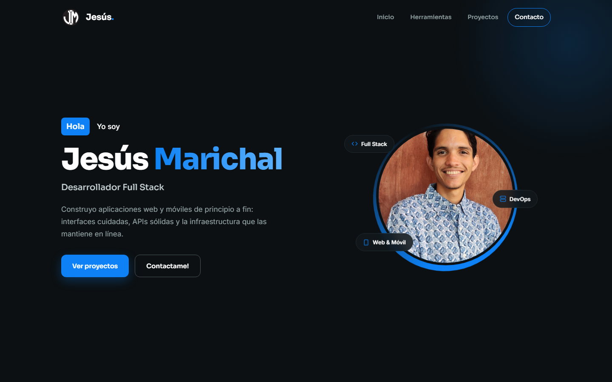

# Portafolio Web · Jesús Marichal

Portafolio personal de **Jesús Marichal**, Desarrollador Full Stack.

🔗 **Ver en vivo:** [https://jesusmarichal.github.io/Portafolio_Web/](https://jesusmarichal.github.io/Portafolio_Web/)



## Secciones

- **Inicio:** presentación con foto y accesos rápidos a proyectos y contacto.
- **Herramientas:** carrusel infinito con los lenguajes, frameworks y servicios que uso (se pausa al pasar el cursor).
- **Proyectos:**
  - **PrimeMax**, el proyecto principal: una plataforma de streaming con app móvil y de escritorio (Flutter), app para Smart TV (React Native) y panel administrativo (NestJS + React). Incluye cómo funciona, paso a paso.
  - Otros proyectos con filtros por categoría (Web, Móvil, IA / Datos, Seguridad): CloudCore, Red Neuronal MLB, PESTesting Suite, Sistema de Clínica, Clasificador de Crustáceos, ImpostorVZ, Reproductor de Música y Métodos Numéricos.
- **Contacto:** correo, WhatsApp y GitHub.

## Tecnologías

- HTML5, CSS3 y JavaScript puro, sin frameworks ni proceso de build.
- Iconos SVG en línea (estilo [Lucide](https://lucide.dev)) y logos de [Devicon](https://devicon.dev) y [Simple Icons](https://simpleicons.org).
- Tipografías Sora, Inter y JetBrains Mono de Google Fonts.
- Diseño responsive, animaciones al hacer scroll y soporte para `prefers-reduced-motion`.

## Estructura

```text
Portafolio_Web/
├── index.html          # Estructura de la página e iconos SVG
├── script.js           # Carrusel, menú móvil, filtros y animaciones
├── Estilos/
│   └── estilos.css     # Estilos y diseño responsive
└── Recursos/           # Imágenes (foto, logo, PrimeMax, vista previa)
```

## Ejecutar en local

No necesita instalar nada: abre `index.html` en el navegador.

También puedes servirlo con un servidor local:

```bash
npx serve .
```

## Personalizar

- **Herramientas del carrusel:** edita el arreglo `herramientas` al inicio de `script.js`.
- **Proyectos:** cada tarjeta es un `<article class="proyecto">` en `index.html`. El atributo `data-cat` define su filtro (`web`, `movil`, `ia`, `seguridad`).
- **Iconos:** cambia el nombre en `<use href="#i-...">` por cualquiera de los definidos al inicio de `index.html`.

## Despliegue

El sitio se publica con **GitHub Pages** desde la rama `main`. Cada `push` actualiza [la versión en vivo](https://jesusmarichal.github.io/Portafolio_Web/).

## Contacto

- Correo: [jesusmarichal0@gmail.com](mailto:jesusmarichal0@gmail.com)
- GitHub: [@JesusMarichal](https://github.com/JesusMarichal)
